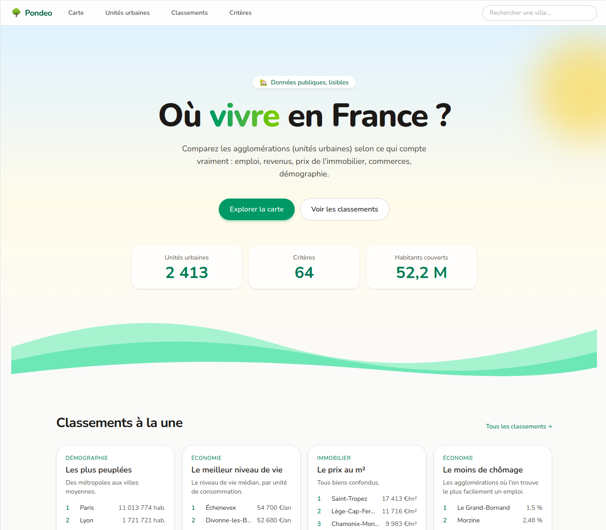

# Pondeo

A website to compare French areas (cities, departments, regions, ...) according
to multiple criteria: income, housing, real estate prices, climate, risks,
commerces, access to train stations, and more. Everything is built from public
data.

Live site: <https://pondeo.bbnt.me>.



## Getting started

**Requirements:** Docker with Compose, `make` and [Git LFS](https://git-lfs.com/)
(the data under `resources/geo` is stored with it).

```bash
make serve-standalone
```

The first run builds the images, installs the dependencies and imports all
the data, which takes a few minutes. Then visit <http://localhost:8080>.
Re-running it is safe: it only applies what changed.

If you work on several branches at once, `make serve` gives each git worktree
its own HTTPS hostname (`https://<directory name>.pondeo.localhost`) behind a
machine-wide dev proxy. See [`docs/local-environment.md`](docs/local-environment.md).
Run `make help` to list the other commands.

## Stack

Symfony 8.1 on PHP 8.5, PostgreSQL with PostGIS, Doctrine, Twig, Stimulus and
Turbo, served through Docker Compose.

## Data

The data is imported from the files committed under `resources/geo`, which are
derived from public sources (INSEE, data.gouv.fr, Open-Meteo, SNCF, ...). Each
criterion's source and import are described in [`docs/`](docs/), starting with
[`docs/criteria-import.md`](docs/criteria-import.md). Licences are listed in
[`docs/data-sources.md`](docs/data-sources.md).

## Deployment

Every merge to `main` deploys the site and updates its database in place.
See [`docs/deployment.md`](docs/deployment.md).

## Contributing

See [`CONTRIBUTING.md`](CONTRIBUTING.md).

## License

The code is released under the [MIT License](LICENSE). The data under
`resources/geo` stays under the licence of its original source, see the
[`docs/data-sources.md`](docs/data-sources.md).
